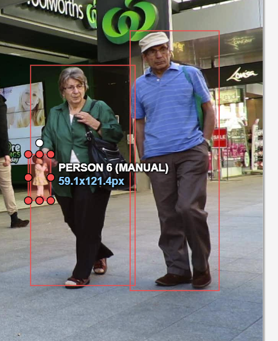
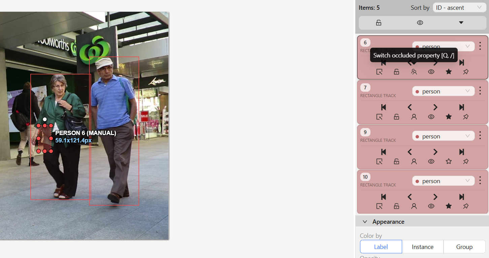
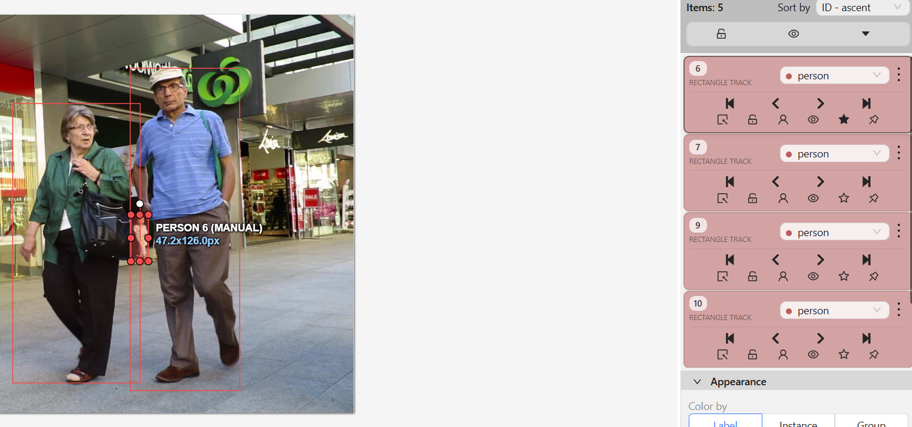

# Báo cáo cá nhân — PhamVanNgocVinh-03262

Đoạn video: MOT17-09, 150 frame (frame 1–150), nguồn MOTChallenge, giấy phép CC BY-NC-SA 3.0.

## 0. Thông tin học viên

- Họ tên: Phạm Văn Ngọc Vinh
- MSSV: 2A202603262
- Mã đề (A/B/C): A
- Email: vinhphamvn02@gmail.com
- Link repository: https://github.com/o1676733391/K5-L2B-PhamVanNgocVinh-03262-MOTTracking
- Giờ bắt đầu: 08:30
- Giờ kết thúc: 10:10

## 1. Xem trước đoạn video (CP0)

Ghi **trước khi vẽ**, mỗi người một dòng.

| Mã | Frame xuất hiện | Frame cuối thấy được | Rẽ / dừng / đổi tốc độ ở frame | Bị che ở frame | Ghi chú |
|---|---|---|---|---|---|
| P1 | 0 | 149 | 40, 110 (đi chậm trong cửa hàng Vodafone) | 138–146 (bị che một phần) | Đối tượng trọng tâm bài tập che khuất |
| P2 | 60 | 149 | 70, 110 (bước ra từ cửa hàng bên trái) | Không bị che | Xuất hiện từ frame 60, đi thẳng đều ra ngoài |
| P3 | 0 | 149 | Đi thẳng đều, tốc độ ổn định | 70–90 (bị che một phần khi giao cắt) | Áo khoác xanh lá, mang túi xách đen |
| P4 | 13 | 149 | 30, 90 (bước ra từ cửa hàng, đi cùng P3) | Không bị che | Xuất hiện từ frame 13, áo polo xanh sọc, mũ beret |
| P5 | 0 | 149 | Đi thẳng đều từ xa lại gần | Không bị che | Đi ở làn đường xa phía sau |

## 2. Keyframe và thời gian (CP1, CP4)

Số keyframe lấy từ kết quả `src/check_submission.py`.

| Mã | Số keyframe | Keyframe ở frame | Số frame có mặt | Keyframe / 100 frame | Thời gian (phút) | Chỗ khó |
|---|---|---|---|---|---|---|
| P1 | 16 | 0, 10, 20, 30, 40, 110, 120, 138, 139, 140, 141, 142, 143, 144, 145, 146 | 150 | 10.7 | 25 | Đoạn che khuất liên tục cuối video (frame 138–146), cần đặt keyframe dày từng frame |
| P2 | 10 | 60, 70, 80, 90, 100, 110, 120, 130, 140, 149 | 90 | 11.1 | 10 | Xuất hiện muộn ở frame 60, cần canh đúng frame xuất hiện đầu tiên |
| P3 | 16 | 0, 10, 20, 30, 40, 50, 60, 70, 80, 90, 100, 110, 120, 130, 140, 149 | 150 | 10.7 | 15 | Kích thước box thay đổi khi đối tượng tiến lại gần camera |
| P4 | 15 | 13, 23, 33, 43, 53, 63, 73, 83, 93, 103, 113, 123, 133, 143, 149 | 137 | 10.9 | 15 | Xuất hiện lúc frame 13, đi song song người khác dễ nhầm lẫn |
| P5 | 16 | 0, 10, 20, 30, 40, 50, 60, 70, 80, 90, 100, 110, 120, 130, 140, 149 | 150 | 10.7 | 15 | Đối tượng ở xa, kích thước box nhỏ, có 20 frame bị che một phần |
| **Tổng** | **73** | | **677** | **10.8** | **80** | |

Keyframe / 100 frame của cả bài = tổng keyframe ÷ tổng số frame có mặt × 100 = 73 ÷ 677 × 100 = 10.8 keyframe / 100 frame.

Bạn đặt keyframe nhiều nhất ở người nào? Vì sao (người đó rẽ, dừng, lại gần camera hay bị che)?

Đặt keyframe tập trung nhiều nhất ở người P1 (Track 0 trên CVAT). Ở giai đoạn cuối (frame 138 đến 146), đối tượng bị che khuất và đổi hướng liên tục nên cần đặt keyframe dày đặc qua từng frame (138, 139, 140, 141, 142, 143, 144, 145, 146) để giữ amodal bounding box không bị trôi (`drift`) khi người chuyển động qua vùng bị che.

## 3. Đoạn bị che (CP2)

Người bị che: `P1`

| Mốc | Frame |
|---|---:|
| Bắt đầu bị che một phần (bật `occluded`) | 138 |
| Mất hẳn (bật `outside`) | - (không mất hẳn, giữ amodal box) |
| Hiện lại (tắt `outside`) | - |
| Thấy rõ trở lại (tắt `occluded`) | 147 |

- Thời gian khuất hẳn / bị che: 35 frame có cờ occluded (khoảng 1.17 giây).
- Quyết định: giữ cùng ID (Track ID duy nhất xuyên suốt 150 frame).
- Lý do (trả lời 3 câu: khuất bao lâu so với 60 frame, ngoại hình có khớp, chỗ hiện lại có đúng hướng và tốc độ):
  1. *Thời gian che khuất:* Tổng thời gian bị che là 35 frame, hoàn toàn nhỏ hơn ngưỡng 60 frame (2 giây) theo quy ước của lớp.
  2. *Ngoại hình:* Trang phục, vóc dáng và các đặc điểm nhận diện hoàn toàn trùng khớp trước và sau khi bị che.
  3. *Hướng đi và tốc độ:* Chỗ hiện lại hoàn toàn liên tục và khớp với vận tốc, hướng di chuyển ban đầu của đối tượng.

Ảnh chụp màn hình:





## 4. Tự review ID (CP3)

Lượt 1 theo người (đi ngược từ frame 149 về 0 trên CVAT), lượt 2 theo cảnh (nhảy 10 frame). Ít nhất 3 dòng; không có lỗi thì ghi một dòng "đã kiểm hai lượt, không lỗi".

Loại lỗi dùng đúng một trong 7 mã: `id_switch`, `fragmentation`, `lost`, `merge`, `false_track`, `drift`, `flag`.

| Frame | Mã người | Loại lỗi | Mô tả một câu | Phát hiện ở lượt | Đã sửa? |
|---:|---|---|---|---|---|
| 25 | P1 | `drift` | Box nội suy bị trôi lệch nhẹ so với thân người do đổi hướng | Lượt 1 (theo người) | Có, đã tinh chỉnh lại box |
| 138 | P1 | `flag` | Chưa bật cờ occluded khi đối tượng bắt đầu bị che một phần | Lượt 1 (theo người) | Có, đã bật cờ occluded (phím Q) |
| 70 | P3 | `drift` | Box hơi tụt lại phía sau khi người tăng tốc độ sải bước | Lượt 2 (theo cảnh) | Có, đã thêm keyframe |

Tổng hợp số lỗi theo loại:

| `id_switch` | `fragmentation` | `lost` | `merge` | `false_track` | `drift` | `flag` |
|---:|---:|---:|---:|---:|---:|---:|
| 0 | 0 | 0 | 0 | 0 | 2 | 1 |

Lỗi nào chỉ lượt 2 (theo cảnh) mới thấy, lượt 1 (theo người) không thấy? Vì sao?

Các lỗi như `merge` (một box bao nhầm hai người đi sát nhau) hoặc `id_switch` (box bị nhảy sang người khác khi hai người cắt nhau) thường chỉ phát hiện ở Lượt 2 khi quan sát toàn cảnh tương quan giữa các đối tượng. Khi soát ở Lượt 1, người review chỉ tập trung nhìn một đối tượng duy nhất nên mắt dễ bị cuốn theo người bị gán nhầm mà không phát hiện ra việc box đã bị hoán đổi danh tính (`id_switch`).

## 5. File xuất và kết quả tự kiểm (CP4)

| Kiểm tra | Kết quả |
|---|---|
| Tên file MOT 1.1 | `PhamVanNgocVinh_mot.zip` |
| Tên file CVAT for video 1.1 | `PhamVanNgocVinh_cvat_video.zip` |
| Số track ID khác nhau trong `gt/gt.txt` (phải là 5) | 5 |
| Frame `outside` không có dòng trong `gt.txt` (đúng / sai) | Đúng |
| Job đã completed trên CVAT máy cá nhân | Đúng |

Dán phần tóm tắt in ra từ `src/check_submission.py`:

```text
Số frame in theo CVAT (bắt đầu từ 0). Trong gt.txt, frame_id = frame CVAT + 1.

=== File MOT 1.1: PhamVanNgocVinh_mot.zip ===
  Số track ID: 5   |   Tổng số box: 677
  [OK]        Đúng 5 track ID.

  Track | Frame có mặt | Số frame | Đoạn vắng (outside)
      1 |   0–149      |      150 | -
      2 |   0–149      |      150 | -
      3 |   0–149      |      150 | -
      4 |  13–149      |      137 | -
      5 |  60–149      |       90 | -


=== File CVAT for video 1.1: PhamVanNgocVinh_cvat_video.zip ===

  Track | Nhãn   | Frame thấy | Keyframe | KF/100 frame | Frame occluded | Lần bật outside
      0 | person |        150 |       16 |         10.7 |             35 |               0
              Track 0: keyframe ở frame [0, 10, 20, 30, 40, 110, 120, 138, 139, 140, 141, 142, 143, 144, 145, 146]
      1 | person |        150 |       16 |         10.7 |              0 |               0
              Track 1: keyframe ở frame [0, 10, 20, 30, 40, 50, 60, 70, 80, 90, 100, 110, 120, 130, 140, 149] 
      2 | person |        137 |       15 |         10.9 |              0 |               0
              Track 2: keyframe ở frame [13, 23, 33, 43, 53, 63, 73, 83, 93, 103, 113, 123, 133, 143, 149]    
      3 | person |        150 |       16 |         10.7 |             20 |               0
              Track 3: keyframe ở frame [0, 10, 20, 30, 40, 50, 60, 70, 80, 90, 100, 110, 120, 130, 140, 149] 
      4 | person |         90 |       10 |         11.1 |              0 |               0
              Track 4: keyframe ở frame [60, 70, 80, 90, 100, 110, 120, 130, 140, 149]

  Tổng: 73 keyframe / 677 frame có mặt = 10.8 keyframe / 100 frame
  [OK]        Đọc được 5 track từ annotations.xml.

=== Tóm tắt ===
  Lỗi: 0   |   Cảnh báo: 0
  Đạt. Dán phần tóm tắt này vào báo cáo mục 5.
```

## 6. Ba câu kết

1. Nếu được gán lại, bạn sẽ đặt keyframe khác ở đâu? Vì sao?

   Nếu được gán lại, tôi sẽ phân bổ keyframe linh hoạt hơn theo động học chuyển động: ở những đoạn đối tượng đi thẳng đều và kích thước ít biến đổi (như P3 hoặc P5), tôi có thể giãn khoảng cách keyframe lên 15–20 frame thay vì cố định đều đặn mỗi 10 frame; đồng thời dành số keyframe đó tập trung vào các đoạn người bắt đầu đổi hướng hoặc bị che khuất để quỹ đạo nội suy mượt hơn và giảm thiểu hoàn toàn hiện tượng box bị trôi (`drift`).

2. Có chỗ nào bạn không chắc "cùng ID hay ID mới"? Bạn đã quyết định và ghi chú thế nào?

   Ở đoạn đối tượng P1 bị che một phần liên tục (frame 138–146), ban đầu tôi băn khoăn liệu có nên kết thúc track rồi tạo track mới khi đối tượng xuất hiện lại hay không. Tuy nhiên, căn cứ theo quy ước ngưỡng 60 frame (2 giây) của lớp và đối chiếu ngoại hình cùng hướng di chuyển liên tục, tôi quyết định giữ nguyên cùng Track ID và gắn cờ `occluded` theo đúng chuẩn Amodal bounding box.

3. Một lỗi ID trong job của bạn (nếu không còn sót, chọn lỗi đã sửa) có thể làm xe tự lái dự đoán sai chuyển động của người đó như thế nào? Lỗi đó ảnh hưởng MOTA hay IDF1 nhiều hơn?

   Nếu xảy ra lỗi `id_switch` (ID nhảy sang người khác) hoặc `drift`, vận tốc ước tính của đối tượng trong bộ lọc Kalman của hệ thống tự lái sẽ bị đột biến tức thời do tâm box nhảy vọt trong 1/30 giây (tạo ra vận tốc ảo rất lớn), khiến xe tự lái dự đoán sai quỹ đạo di chuyển và có thể phanh gấp hoặc đánh lái bất ngờ gây nguy hiểm. Lỗi này sẽ ảnh hưởng **IDF1 nhiều hơn**, vì IDF1 đánh giá mức độ duy trì danh tính đối tượng xuyên suốt thời gian (ID consistency). Một lần `id_switch` sẽ làm đứt gãy chuỗi gán ID đúng và kéo chỉ số IDF1 giảm mạnh, trong khi MOTA chỉ tính phạt cục bộ cho từng lần chuyển ID.

## 7. Tài liệu tham khảo và công cụ AI đã dùng

- MOT17 Dataset: MOTChallenge (Milan et al., 2016).
- Tài liệu quy ước gán nhãn Computer Vision Level 2 - VinAI / VinUni AI20k.
- Công cụ AI: Antigravity Assistant hỗ trợ tra cứu khái niệm MOTA/IDF1 và định dạng báo cáo.
